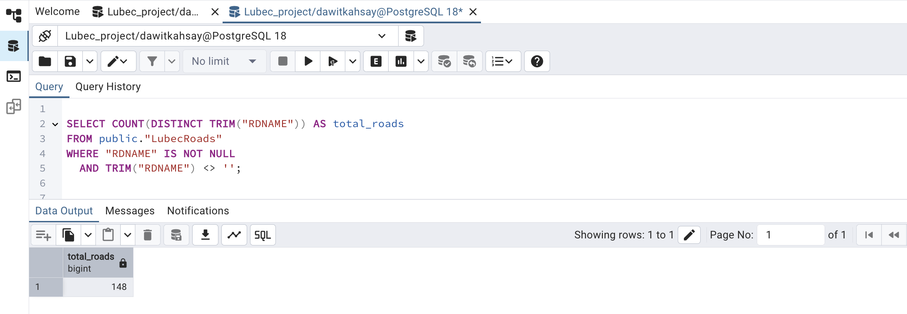
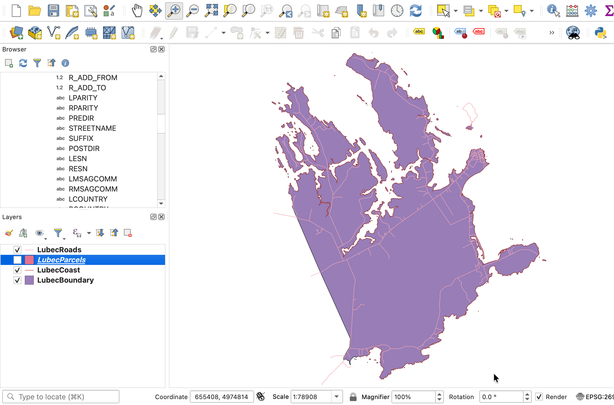
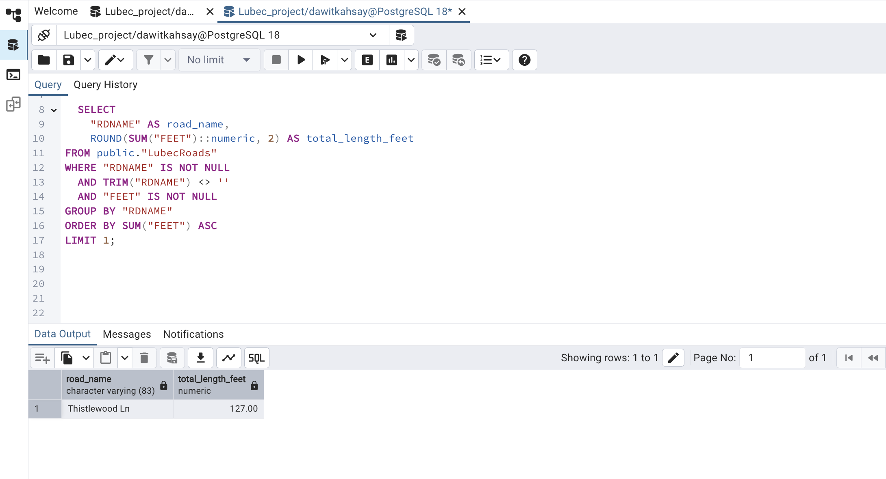
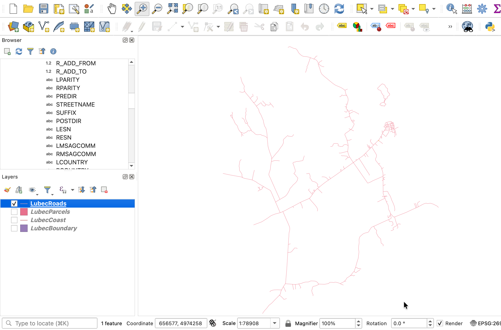
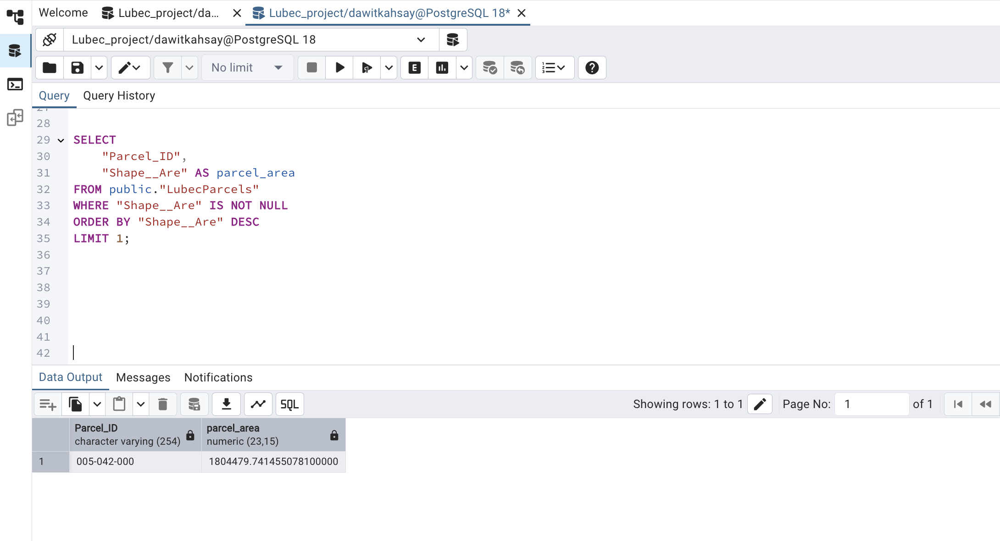
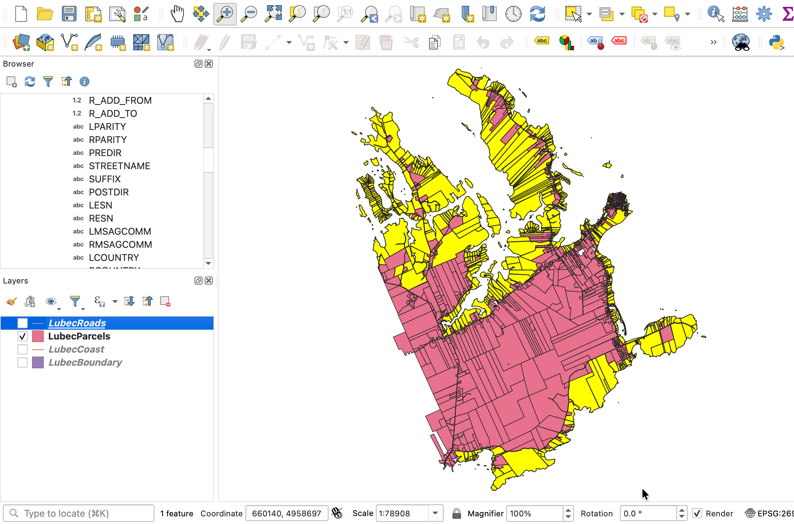
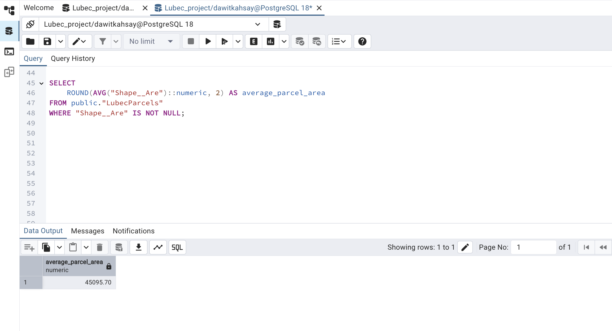
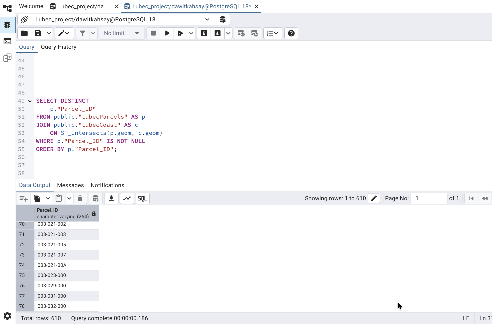
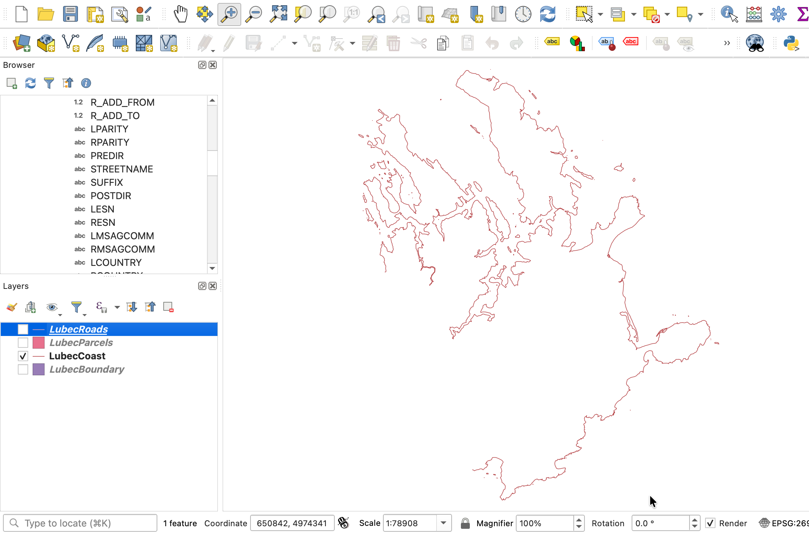

# Lubec Spatial Database Analysis
### Spatial Database Management and Geospatial Analysis Using PostgreSQL, PostGIS, SQL, and QGIS

## 1. Project Overview

This project focuses on managing, querying, and analyzing geographic data for Lubec, Maine. It demonstrates how spatial databases can be used to organize geographic information, perform SQL-based analysis, and communicate spatial findings through GIS maps.

Using PostgreSQL and PostGIS, I worked with multiple geographic datasets representing roads, land parcels, coastline features, and the Lubec administrative boundary. I developed spatial and attribute-based queries to investigate geographic characteristics and relationships among these datasets.

QGIS was used to connect to the spatial database, explore geographic features, and visualize the results of the analysis.

This project is part of my graduate studies in the M.S. in Data Science and Engineering program at the University of Maine.

## 2. Project Objectives

The main objectives were to:

- Work with geographic datasets in a relational spatial database.
- Organize and manage spatial information using PostgreSQL and PostGIS.
- Write SQL queries to retrieve, filter, and analyze geographic records.
- Explore relationships between roads, parcels, and coastline features.
- Apply spatial functions to investigate geographic relationships.
- Visualize spatial datasets and analytical results using QGIS.
- Develop practical experience with spatial database workflows.

## 3. Study Area

**Location:** Lubec, Maine, United States.

The project uses geographic datasets representing different features of the Lubec area. These datasets provide the foundation for exploring transportation networks, land parcels, coastal geography, and administrative boundaries.

## 4. Data and Spatial Layers

The project uses four primary geographic layers:

| Dataset | Description |
|---|---|
| LubecBoundary | Geographic boundary of the study area |
| LubecRoads | Road features within the study area |
| LubecParcels | Land parcel information |
| LubecCoast | Coastal geographic features |

These layers were used together to explore geographic information and perform spatial analysis.

## 5. Spatial Database and Technologies

**PostgreSQL**

Used as the relational database management system for storing and querying project data.

**PostGIS**

Used to support geographic data and spatial SQL operations within PostgreSQL.

**SQL**

Used to retrieve records, perform calculations, filter datasets, and investigate spatial relationships.

**QGIS**

Used to connect to the spatial database, inspect geographic layers, and create map visualizations.

## 6. Analysis and SQL Queries

The project investigates five analytical questions.

### Question 1: Road Feature Analysis
How many road features are represented in the Lubec roads dataset?

This analysis uses SQL to count road records and understand the size of the transportation dataset.

### Question 2: Shortest Road Identification
Which road feature has the shortest recorded length?

This analysis examines road attributes to identify the shortest road in the dataset.

### Question 3: Largest Residential Parcel
Which residential parcel has the largest recorded area?

This analysis uses parcel attributes to identify the largest residential parcel.

### Question 4: Average Residential Parcel Area
What is the average area of residential parcels?

This analysis calculates an average to summarize the size of residential parcels in the study area.

### Question 5: Coastal Parcel Analysis
Which parcels intersect the coastline?

This analysis uses the PostGIS `ST_Intersects` spatial function to examine the geographic relationship between parcel features and coastal features.

## 7. GIS Visualization

QGIS was used to visualize the geographic datasets and explore their spatial relationships.

The map layers include:
- Administrative boundary
- Road network
- Land parcels
- Coastline features

The visualizations provide a geographic perspective on the database analysis and help communicate the spatial characteristics of the study area.

## 8. Project Workflow

The project follows a practical spatial database workflow:

1. **Data Preparation:** Work with the geographic datasets provided for the Lubec study area.
2. **Database Management:** Use PostgreSQL and PostGIS to work with spatial data.
3. **SQL Analysis:** Develop queries to investigate roads, residential parcels, and coastal relationships.
4. **Spatial Analysis:** Apply spatial SQL functions to identify geographic relationships.
5. **GIS Visualization:** Connect QGIS to the data and visualize geographic features.
6. **Documentation:** Organize SQL queries, results, maps, and project files for reproducibility and portfolio presentation.

## 9. Skills Demonstrated

- Relational Database Management
- PostgreSQL
- PostGIS
- SQL Query Development
- Spatial SQL
- Geographic Data Management
- QGIS
- Geospatial Data Visualization
- Spatial Relationship Analysis
- Data Analysis and Documentation

## 10. Repository Structure

```text
Lubec-Spatial-Database-Analysis/
│
├── README.md
│
├── QGIS/
│   └── LubecProject.qgz
│
├── SQL/
│   └── spatial_analysis_queries.sql
│
├── Analysis/
│   ├── Q1_Count_Roads/
│   ├── Q2_Shortest_Road/
│   ├── Q3_Largest_Residential_Parcel/
│   ├── Q4_Average_Residential_Area/
│   └── Q5_Coastal_Parcels/
│
└── Setup/
    └── Database_and_QGIS_Setup/
```

## 11. Project Outcome

This project provided practical experience working with spatial datasets in a relational database environment. It combined SQL querying, PostGIS spatial functionality, and QGIS visualization into a single geospatial analysis workflow.

It also strengthened my understanding of how spatial databases can support geographic data management, land analysis, and GIS applications.


## 12. Project Screenshots

### Question 1: Road Analysis



### Question 2: Shortest Road



### Question 3: Largest Parcel



### Question 4: Average Parcel Area



### Question 5: Coastal Parcel Analysis




## 13. Academic Context

**Program:** M.S. Data Science and Engineering  
**University:** University of Maine  
**Course:** SIE 555 – Spatial Database Systems

---

**Author:** Dawit Kahsay  
**Focus:** Spatial Data Engineering | GIS | Geospatial Databases

